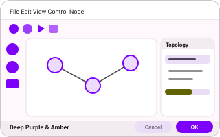
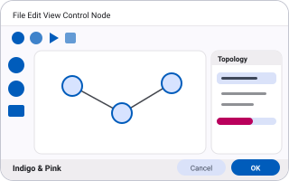
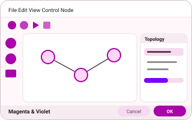
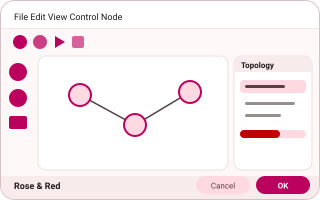
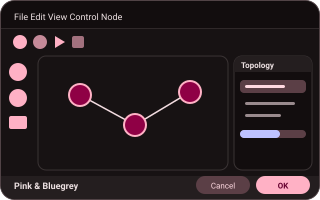
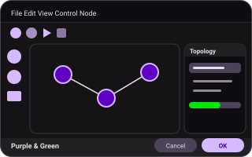
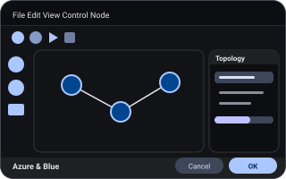
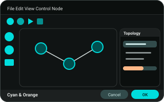
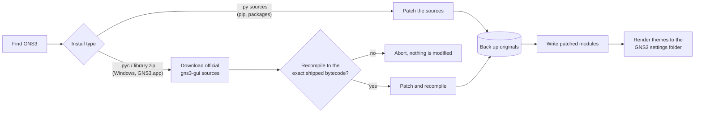

<div align="center">

# mygns3theme

**Material 3 themes for the GNS3 desktop GUI on Windows, Linux and macOS.**

The 8 color themes of the GNS3 3.x Web UI, brought to the native desktop client.

[](https://github.com/ivaniv4/mygns3theme/releases/latest)
[](https://github.com/ivaniv4/mygns3theme/actions/workflows/ci.yml)
[](LICENSE)
[](#installation)
[](https://www.gns3.com/)
[](https://www.python.org/)



**[Download](https://github.com/ivaniv4/mygns3theme/releases/latest)** ·
**[Themes](#themes)** ·
**[Installation](#installation)** ·
**[Customization](#customization)**

</div>

---

## Table of contents

- [Features](#features)
- [Themes](#themes)
- [Requirements](#requirements)
- [Installation](#installation)
- [Switching themes](#switching-themes)
- [Customization](#customization)
- [How it works](#how-it-works)
- [Updating GNS3](#updating-gns3)
- [Uninstallation](#uninstallation)
- [Command reference](#command-reference)
- [Project structure](#project-structure)
- [Troubleshooting](#troubleshooting)
- [Contributing](#contributing)
- [Credits](#credits)
- [License](#license)

## Features

- **8 Material 3 themes**: the exact palettes of the GNS3 3.x Web UI, 4 light and 4 dark.
- **Cross-platform**: Windows, Linux (pip, pipx or distribution packages) and macOS (`GNS3.app`).
- **One script per platform**: it finds GNS3, gets the right Python, closes GNS3, patches it, lets you pick a theme and restarts GNS3.
- **Switch themes from GNS3 itself**: every theme is listed in *Preferences > Interface style*.
- **Modern widgets**: pill buttons, underlined tabs, rounded inputs and menus, toolbar icons tinted to match the theme.
- **Safe**: original files are backed up, and frozen builds are only patched after their bytecode is checked against the official sources.
- **Reversible** with one script.
- **No dependencies**: standard library Python only.

## Themes

The palettes are extracted from the GNS3 Web UI (`theme-*` classes), so the desktop client matches the browser.

<table>
  <tr>
    <td align="center"><br><b>Deep Purple &amp; Amber</b><br><sub>light · <code>deeppurple-amber</code></sub></td>
    <td align="center"><br><b>Indigo &amp; Pink</b><br><sub>light · <code>indigo-pink</code></sub></td>
  </tr>
  <tr>
    <td align="center"><br><b>Magenta &amp; Violet</b><br><sub>light · <code>magenta-violet</code></sub></td>
    <td align="center"><br><b>Rose &amp; Red</b><br><sub>light · <code>rose-red</code></sub></td>
  </tr>
  <tr>
    <td align="center"><br><b>Pink &amp; Bluegrey</b><br><sub>dark · <code>pink-bluegrey</code></sub></td>
    <td align="center"><br><b>Purple &amp; Green</b><br><sub>dark · <code>purple-green</code></sub></td>
  </tr>
  <tr>
    <td align="center"><br><b>Azure &amp; Blue</b><br><sub>dark · <code>azure-blue</code></sub></td>
    <td align="center"><br><b>Cyan &amp; Orange</b><br><sub>dark · <code>cyan-orange</code></sub></td>
  </tr>
</table>

## Requirements

| | Windows | Linux | macOS |
| --- | --- | --- | --- |
| **GNS3** | 2.2 or 3.x installer | pip, pipx or distribution package | `GNS3.app` |
| **Python** | Same version as GNS3 (3.13 for GNS3 3.1), installed for you with `winget` | Any Python 3.10+ | Same version as GNS3, installed for you with Homebrew |
| **Internet** | Needed once to fetch the official GNS3 sources | Not needed | Needed once to fetch the official GNS3 sources |
| **Rights** | Administrator (UAC prompt) | `sudo` only for system-wide installs | Administrator only if the app is not writable |

> [!NOTE]
> Frozen builds (Windows installer, `GNS3.app`) contain compiled Python bytecode, which can only be rebuilt by the same Python version. The installers detect that version and take care of it.

## Installation

Download the archive for your platform from the **[latest release](https://github.com/ivaniv4/mygns3theme/releases/latest)**:

| Platform | Archive | Script |
| --- | --- | --- |
| Windows | `mygns3theme-<version>-windows.zip` | `install.cmd` |
| Linux / macOS | `mygns3theme-<version>-linux-macos.tar.gz` | `install.sh` |

### Windows

1. Extract the zip.
2. Double-click **`install.cmd`**.
3. Pick a theme, then accept the UAC prompt.

Or from PowerShell, without questions:

```powershell
.\install.ps1 -Theme "Azure & Blue" -Yes
```

### Linux / macOS

```sh
tar -xzf mygns3theme-*-linux-macos.tar.gz
cd mygns3theme-*-linux-macos
./install.sh
```

Or without questions:

```sh
./install.sh --theme cyan-orange --yes
```

<details>
<summary><b>What the installer does</b></summary>
<br>

1. Finds GNS3: `C:\Program Files\GNS3`, `/Applications/GNS3.app`, or the Python package behind the `gns3` command.
2. Finds the Python version needed to patch it, and offers to install it (`winget` on Windows, Homebrew on macOS).
3. Offers to close GNS3 if it is running.
4. Shows the theme picker.
5. Patches GNS3, elevating only if the install is not writable (UAC prompt or `sudo`).
6. Installs every theme in the GNS3 settings folder and selects yours.
7. Offers to start GNS3.

</details>

<details>
<summary><b>From a clone of the repository</b></summary>
<br>

```sh
git clone https://github.com/ivaniv4/mygns3theme.git
cd mygns3theme
./unix/install.sh             # Linux / macOS
.\windows\install.cmd         # Windows
```

</details>

> [!IMPORTANT]
> If GNS3 asks *"Are you sure you want to exit GNS3?"* while the installer closes it, answer **Yes**: projects are kept on the GNS3 server.

## Switching themes

Every installed theme is listed in GNS3 under **Edit > Preferences > General > Interface style**. Restart GNS3 after switching.

From a terminal (with GNS3 closed):

```sh
python mygns3theme.py list
python mygns3theme.py select "Purple & Green"
```

## Customization

Themes are plain JSON files in [`themes/`](themes), using the [Material 3 color roles](https://m3.material.io/styles/color/roles):

```json
{
    "name": "Azure & Blue",
    "mode": "dark",
    "colors": {
        "primary": "#ABC7FF",
        "on_primary": "#002F65",
        "surface": "#121316",
        "...": "..."
    },
    "overrides": { "font_size": "11pt" }
}
```

Edit a theme or add your own, then run `python mygns3theme.py apply` and restart GNS3. No new patch and no admin rights are needed.

<details>
<summary><b>Derived values and overridable tokens</b></summary>
<br>

| Token | Default |
| --- | --- |
| `primary_hover`, `primary_pressed` | `primary` blended with `on_primary` (8 % / 16 %) |
| `secondary_container_hover`, `secondary_container_pressed` | `secondary_container` blended with `on_secondary_container` |
| `disabled_text` | `on_surface` at 38 % over `surface` |
| `canvas` | `surface_container_lowest` (light) or `surface` (dark) |
| `drawing_grid`, `node_grid` | `canvas` blended with `outline_variant` |
| `icon`, `icon_active`, `tint_icons` | `primary`, `on_primary_container`, `true` |
| `font_family`, `font_size`, `mono_font_family` | Segoe UI, Helvetica Neue or Sans Serif, depending on the OS |

Any of them can be set in a theme's `overrides`. The Qt style sheet itself is [`template/style.qss`](template/style.qss), where each `@token@` is replaced by its value.

</details>

## How it works

GNS3 has no theme API, so mygns3theme patches the three GUI modules that handle styles (`settings`, `main_window`, `style`) to add one style per installed theme. The themes themselves are data, rendered into the GNS3 settings folder.



| Install type | Where | What is patched |
| --- | --- | --- |
| Windows installer | `C:\Program Files\GNS3\lib\library.zip` | `.pyc` inside the zip |
| macOS app | `GNS3.app/Contents/...` | `.pyc` (loose or zipped), then the app is re-signed ad hoc |
| pip / pipx / packages | `site-packages/gns3/` | `.py` sources |

The theme files go to `%APPDATA%\GNS3\mygns3theme` on Windows and `~/.config/GNS3/mygns3theme` on Linux and macOS (`$XDG_CONFIG_HOME` is honored).

## Updating GNS3

Upgrading GNS3 replaces the patched files. Run the installer again afterwards: it notices the new version, refreshes the backup and patches it. If the sources of a new frozen build do not match its bytecode, it stops instead of risking a broken install.

## Uninstallation

| Platform | Script |
| --- | --- |
| Windows | double-click `uninstall.cmd` |
| Linux / macOS | `./uninstall.sh` |

The uninstaller switches GNS3 back to the Classic style, restores the original GNS3 files and deletes the theme files.

## Command reference

`mygns3theme.py` does the work behind the installers and can be used directly:

| Command | Description | Admin |
| --- | --- | :---: |
| `detect [--json]` | Describe the GNS3 install (type, version, Python needed, writable) | |
| `patch` | Add theme support to GNS3 | yes* |
| `unpatch` | Restore the original GNS3 files | yes* |
| `apply [--theme T] [--no-select]` | Install every theme and select one | |
| `list [--json]` | List the themes | |
| `select THEME` | Select an installed theme | |
| `reset-style` | Switch GNS3 back to the Classic style | |
| `remove-themes` | Delete the installed theme files | |
| `status` | Show the installation state | |
| `selftest [--gns3-version V]` | Render every theme and patch the official sources (used by CI) | |

<sub>* only when the GNS3 install is not writable by your user. Global option: `--gns3-dir PATH` (install folder, `library.zip`, `.app` bundle or `gns3` package folder).</sub>

## Project structure

```text
mygns3theme/
├── mygns3theme.py            # cross-platform CLI: detect / patch / apply / ...
├── windows/
│   ├── install.cmd           # double-click installer (runs install.ps1)
│   ├── install.ps1
│   ├── uninstall.cmd
│   └── uninstall.ps1
├── unix/
│   ├── install.sh            # Linux / macOS installer
│   └── uninstall.sh
├── patches/                  # code added to GNS3's settings and style modules
├── template/
│   ├── style.qss             # Qt style sheet shared by every theme
│   └── assets/               # SVG arrows and check mark
├── themes/                   # one JSON file per theme (Material 3 roles)
├── scripts/
│   ├── build_release.py      # builds the Windows and Linux/macOS archives
│   └── make_previews.py      # generates docs/themes/*.svg
├── docs/themes/              # theme previews
└── .github/                  # CI, release workflow, issue and PR templates
```

## Troubleshooting

<details>
<summary><b>"this GNS3 build needs Python 3.x to be patched"</b></summary>

Frozen builds can only be patched by the Python version they were built with. The installers install it for you. When running `mygns3theme.py` by hand, use that version (`py -3.13` on Windows, `python3.13` on macOS).

</details>

<details>
<summary><b>"does not match the installed ... refusing to patch"</b></summary>

Your GNS3 build differs from the official sources of its version tag. Nothing was modified. Please open an issue with the output of `python mygns3theme.py detect`.

</details>

<details>
<summary><b>"GNS3 is still running"</b></summary>

GNS3 may be waiting for you to confirm the exit (running nodes). Answer **Yes**, or close it manually, and run the installer again.

</details>

<details>
<summary><b>macOS: "GNS3 is damaged and can't be opened"</b></summary>

The installer re-signs the app ad hoc after patching. If macOS still refuses it, run `xattr -dr com.apple.quarantine /Applications/GNS3.app`, or reinstall GNS3 and run `install.sh` again.

</details>

<details>
<summary><b>The themes do not appear in Preferences</b></summary>

Run `python mygns3theme.py status`. If GNS3 shows as `original`, an update replaced the patched files: run the installer again.

</details>

## Contributing

Contributions are welcome, especially new themes and testing on Linux distributions and macOS. See [CONTRIBUTING.md](CONTRIBUTING.md). Bug reports and ideas go through the [issue templates](https://github.com/ivaniv4/mygns3theme/issues/new/choose).

## Credits

- [gns3theme](https://github.com/n3oxmind/gns3theme) by n3oxmind (MIT), the original idea of theming the GNS3 GUI by patching it.
- [GNS3](https://github.com/GNS3), the GUI being themed and the source of the Web UI palettes. GNS3 sources are downloaded at install time and are **not** redistributed here.
- [Material Design 3](https://m3.material.io/) for the design language and color roles.

## License

Released under the [MIT License](LICENSE) © 2026 ivaniv4.

---

<div align="center">
<sub>Not affiliated with or endorsed by GNS3 Technologies Inc.</sub>
</div>
