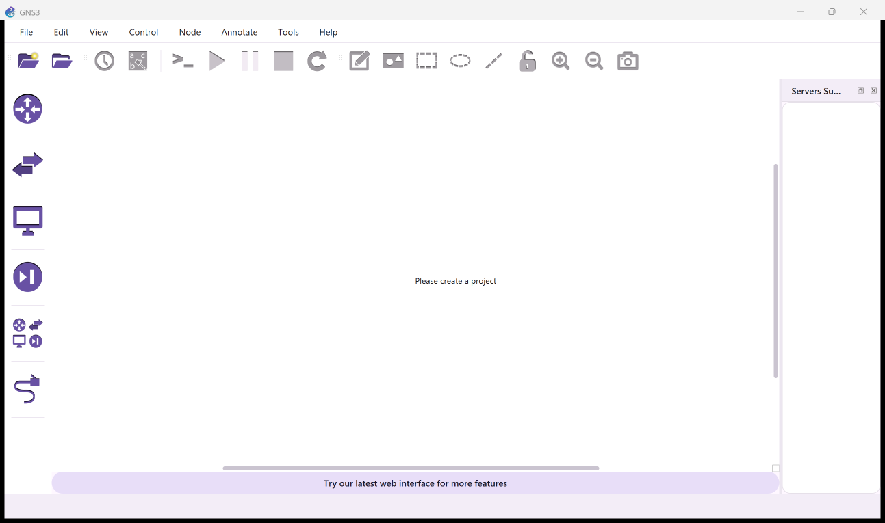
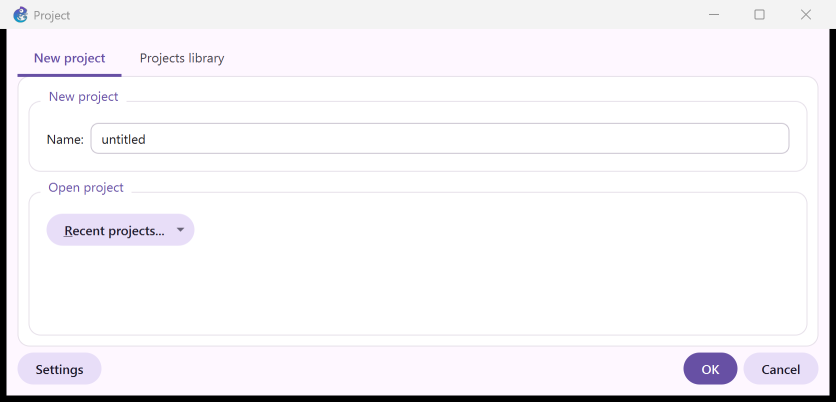
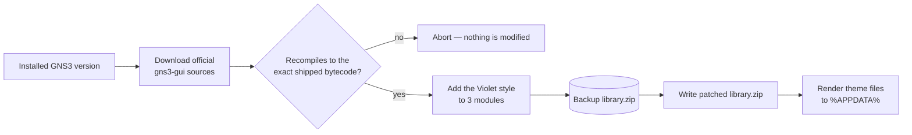

<div align="center">

# 🟣 mygns3theme

**A modern Material 3 "Violet" theme for the GNS3 desktop GUI on Windows.**

Bring the look of the GNS3 3.x Web UI — white surfaces, violet accents, rounded corners — to the native desktop client.

[](LICENSE)
[](#requirements)
[](https://www.gns3.com/)
[](https://www.python.org/)
[](https://doc.qt.io/qtforpython-6/)



</div>

---

## Table of contents

- [Features](#features)
- [Screenshots](#screenshots)
- [Requirements](#requirements)
- [Installation](#installation)
- [Customization](#customization)
- [How it works](#how-it-works)
- [Updating GNS3](#updating-gns3)
- [Uninstallation](#uninstallation)
- [Command reference](#command-reference)
- [Project structure](#project-structure)
- [Troubleshooting](#troubleshooting)
- [Contributing](#contributing)
- [Credits](#credits)
- [License](#license)

## Features

- 🎨 **Material 3 look** modeled on the GNS3 3.x Web UI: pill-shaped buttons, underlined tabs, rounded inputs, groups and menus.
- 💜 **Violet palette** (`#6750A4`) with matching icon tinting that preserves the original icon shading.
- 🔧 **Fully customizable**: every color, font and size lives in a single [`palette.json`](theme/palette.json). No admin rights needed to change it.
- 🛡️ **Safe patching**: sources are verified against the bytecode shipped with your GNS3 version, a backup is always kept, and the tool refuses to patch on any mismatch.
- ♻️ **Fully reversible** with one command.
- 📦 **Zero dependencies**: standard-library Python only.

## Screenshots

| Main window | Project dialog |
| :---: | :---: |
|  |  |

## Requirements

| Requirement | Version |
| --- | --- |
| Operating system | Windows 10 / 11 |
| GNS3 | **3.1** (tested with `3.1.0a7`) |
| Python | **3.13** — must match the Python version bundled with GNS3 |

Install Python 3.13 if needed:

```powershell
winget install Python.Python.3.13
```

> [!NOTE]
> The tool reads the sources of the exact GNS3 version you have installed from the official [`gns3-gui`](https://github.com/GNS3/gns3-gui) repository, so an internet connection is required during installation.

## Installation

1. **Close GNS3.**
2. Clone the repository and run the installer:

   ```powershell
   git clone https://github.com/<your-user>/mygns3theme.git
   cd mygns3theme
   powershell -ExecutionPolicy Bypass -File install.ps1
   ```

3. Accept the **UAC prompt** — it is needed to modify `C:\Program Files\GNS3`.
4. **Start GNS3.** The theme is selected automatically. You can also pick it in
   *Edit → Preferences → General → Interface style → Violet*.

> [!IMPORTANT]
> GNS3 must be closed during installation, because it locks the file that gets patched.

## Customization

Edit [`theme/palette.json`](theme/palette.json) (or work on a copy), then re-apply the theme:

```powershell
py -3.13 mygns3theme.py apply                            # default palette
py -3.13 mygns3theme.py apply --palette my-palette.json  # custom palette
```

Restart GNS3 to see the changes. No administrator rights are required.

<details>
<summary><b>Palette keys</b></summary>

| Key | Purpose |
| --- | --- |
| `primary`, `primary_hover`, `primary_pressed`, `on_primary` | Default buttons, focus rings, selected tabs, checkboxes |
| `primary_container`, `on_primary_container` | Menu bar hover, pressed tool buttons |
| `secondary_container*`, `on_secondary_container` | Buttons, list selection, menu hover |
| `surface`, `surface_lowest` … `surface_highest` | Window, panels, inputs, headers |
| `on_surface`, `on_surface_variant`, `disabled_text` | Text colors |
| `outline`, `outline_variant` | Borders and separators |
| `canvas`, `drawing_grid`, `node_grid` | Topology canvas and its grid |
| `console_text` | Console text color |
| `tint_icons`, `icon`, `icon_active` | Toolbar icon tinting |
| `font_family`, `font_size`, `mono_font_family` | Typography |

</details>

The Qt style sheet itself is [`theme/violet.qss`](theme/violet.qss). Each palette key written between two `@` signs is replaced by its value when the theme is applied.

## How it works

On Windows, GNS3 is frozen with cx_Freeze: its Python modules ship as compiled `.pyc` files inside `lib\library.zip`. The original [gns3theme](https://github.com/n3oxmind/gns3theme) patches `.py` files and therefore only supports Linux and macOS. `mygns3theme` adapts the idea to the frozen build:



1. Sources of `settings.py`, `main_window.py` and `style.py` are fetched for the installed version.
2. They are compiled and compared to the bytecode GNS3 ships. If they differ, **nothing is touched**.
3. A `Violet` entry is added to the list of styles, along with a `setVioletStyle` method ([`patches/style_violet.py`](patches/style_violet.py)).
4. The original archive is saved as `library.zip.mygns3theme-<version>.bak`, then rewritten.
5. The style sheet and palette are rendered to `%APPDATA%\GNS3\mygns3theme`, so colors can change without patching GNS3 again.

## Updating GNS3

The GNS3 installer replaces `library.zip`, which removes the patch. After upgrading, run `install.ps1` again. If the sources of the new version do not match the installed bytecode, the tool stops instead of risking a broken installation.

## Uninstallation

```powershell
powershell -ExecutionPolicy Bypass -File uninstall.ps1
```

This switches GNS3 back to the Classic style and restores the original `library.zip`.

## Command reference

| Command | Description | Admin |
| --- | --- | :---: |
| `py -3.13 mygns3theme.py status` | Show the installation state | |
| `py -3.13 mygns3theme.py patch` | Add the Violet style to GNS3 | ✅ |
| `py -3.13 mygns3theme.py unpatch` | Restore the original GNS3 files | ✅ |
| `py -3.13 mygns3theme.py apply [--palette FILE] [--no-select]` | Render the theme and select it | |
| `py -3.13 mygns3theme.py reset-style` | Switch GNS3 back to the Classic style | |

Global options: `--gns3-dir PATH` (default `C:\Program Files\GNS3`) and `--gns3-version VERSION`.

## Project structure

```text
mygns3theme/
├── mygns3theme.py          # patch / unpatch / apply CLI
├── install.ps1             # one-step installer (handles UAC)
├── uninstall.ps1           # one-step uninstaller
├── patches/
│   └── style_violet.py     # setVioletStyle() added to GNS3's style module
├── theme/
│   ├── palette.json        # colors, fonts, sizes
│   ├── violet.qss          # Qt style sheet template
│   └── assets/             # SVG arrows and check mark
└── docs/images/            # screenshots
```

## Troubleshooting

<details>
<summary><b>"was not built by Python 3.x"</b></summary>

The tool must run with the same Python minor version as GNS3 (3.13 for GNS3 3.1). Use `py -3.13`.

</details>

<details>
<summary><b>"does not match the installed … refusing to patch"</b></summary>

Your GNS3 build differs from the official sources of that version tag. Nothing was modified. Open an issue with your GNS3 version.

</details>

<details>
<summary><b>"close GNS3 before patching"</b></summary>

Quit GNS3 completely (check the system tray and Task Manager) and run the command again.

</details>

<details>
<summary><b>The theme does not appear in Preferences</b></summary>

Run `py -3.13 mygns3theme.py status`. If `library.zip` shows as `original`, the patch was removed by a GNS3 update: run `install.ps1` again.

</details>

## Contributing

Contributions are welcome — see [CONTRIBUTING.md](CONTRIBUTING.md). Bug reports and ideas go through the [issue templates](.github/ISSUE_TEMPLATE).

## Credits

- [gns3theme](https://github.com/n3oxmind/gns3theme) by n3oxmind (MIT) — the original idea of theming the GNS3 GUI by patching it.
- [GNS3](https://github.com/GNS3/gns3-gui) — the GUI being themed. Its sources are downloaded at install time and are **not** redistributed here.
- [Material Design 3](https://m3.material.io/) — design language and baseline violet palette.

## License

Released under the [MIT License](LICENSE).

---

<div align="center">
<sub>Not affiliated with or endorsed by GNS3 Technologies Inc.</sub>
</div>
